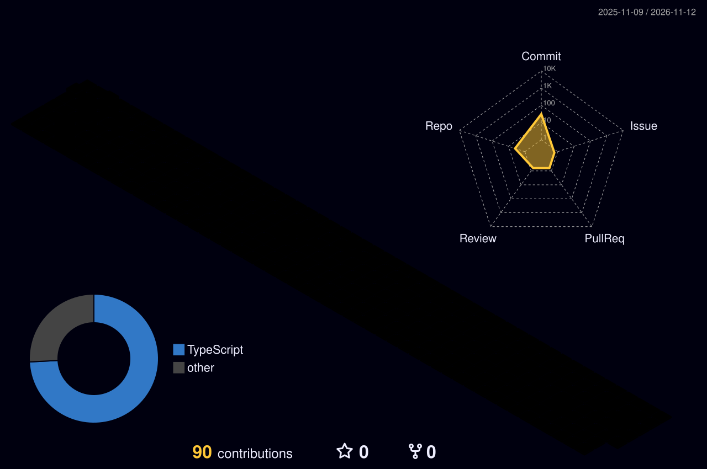

  
  
  

---

## 🛡️ About Me

- 🔐 **Cybersecurity Engineer** from Pakistan
- 🕵️ Interested in **Penetration Testing**, **Vulnerability Assessment** and **Threat Detection**
- 🛡️ Focused on **securing systems** and **defending against real-world threats**
- 🌱 Currently learning **C#** and **Flutter** to build security tooling and apps
- 📫 Reach me at **[usmanshehzad617@gmail.com](mailto:usmanshehzad617@gmail.com)**
- ⚡ Fun fact: **I never stop learning**

 

## 🌐 Connect With Me

  
  
  
  
  

## 🧰 Security Toolkit

  

## 🌆 3D Profile

  <picture>
    <source media="(prefers-color-scheme: dark)" srcset="./profile-3d-contrib/profile-night-rainbow.svg" />
    <source media="(prefers-color-scheme: light)" srcset="./profile-3d-contrib/profile-gitblock.svg" />
    
  </picture>

## 📊 GitHub Stats

  

  

