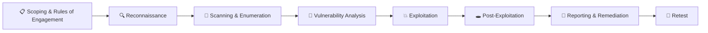

<div align="center">


<a href="https://github.com/Usman-Shehzad">
  
</a>

<p>
  
  
  
</p>

<p>
  
  <a href="https://github.com/Usman-Shehzad?tab=followers"></a>
  <a href="https://github.com/Usman-Shehzad?tab=repositories"></a>
</p>

</div>

<p align="center"></p>

<h2 align="center">🛡️ About Me</h2>

<p align="center"></p>

```bash
usman@kali:~$ cat profile.json
{
  "name"      : "Usman Shehzad",
  "role"      : "Cybersecurity Engineer",
  "location"  : "Pakistan 🇵🇰",
  "focus"     : ["Vulnerability Assessment", "Penetration Testing", "Threat Detection"],
  "mindset"   : "Think like an attacker, defend like an engineer",
  "learning"  : ["C#", "Flutter", "Security Automation"],
  "contact"   : "usmanshehzad617@gmail.com",
  "status"    : "Securing systems, one vulnerability at a time 🔐"
}
```

<h2 align="center">🌐 Connect With Me</h2>

<p align="center">
  <a href="https://linkedin.com/in/usmanshehzad"></a>
  <a href="https://fb.com/usmanshehzad"></a>
  <a href="https://instagram.com/usmanmani"></a>
  <a href="https://www.youtube.com/c/codewithmani"></a>
  <a href="mailto:usmanshehzad617@gmail.com"></a>
</p>

<p align="center"></p>

<h2 align="center">🔐 Core Security Principles</h2>

<div align="center">

| Principle | What it means |
| :--- | :--- |
| 🔒 **Confidentiality** | Only authorized people can access sensitive data |
| ✅ **Integrity** | Data and systems cannot be changed without detection |
| ⚡ **Availability** | Systems and data are there when they are needed |
| 🧱 **Defense in Depth** | Layered controls so one failure is not a breach |
| 🎯 **Least Privilege** | Give users and services only the access they need |
| 🚫 **Zero Trust** | Never trust, always verify, assume breach |
| 🔄 **Secure by Design** | Build security in from the start, not bolt it on |
| 📝 **Accountability** | Log, monitor and audit every important action |

</div>

<h2 align="center">🎯 VAPT Methodology</h2>

<div align="center">



</div>

<div align="center">

| Phase | Goal | Typical Work |
| :--- | :--- | :--- |
| **Scoping** | Agree on targets, limits and authorization | Rules of engagement, written permission |
| **Recon** | Gather information about the target | OSINT, DNS, subdomains, tech stack |
| **Scanning** | Find live hosts, ports and services | Port scans, service and version detection |
| **Vuln Analysis** | Identify and prioritize weaknesses | Automated scans, manual validation, CVSS scoring |
| **Exploitation** | Prove the impact of a weakness | Controlled exploitation of confirmed findings |
| **Post-Exploitation** | Measure how far an attacker could go | Privilege escalation, lateral movement |
| **Reporting** | Communicate risk and fixes | Executive summary, technical findings, remediation steps |
| **Retest** | Confirm fixes work | Verify closed findings |

</div>

<h2 align="center">🧬 Areas I Work In</h2>

<div align="center">

| 🌐 Web App Security | 🖥️ Network Security | 📱 Mobile Security | ☁️ Security Hardening |
| :---: | :---: | :---: | :---: |
| OWASP Top 10, XSS, SQLi, IDOR, auth flaws | Scanning, enumeration, traffic analysis | Android app testing | Linux and server hardening, misconfiguration review |

</div>

<p align="center"></p>

<h2 align="center">🧰 Security Toolkit</h2>

<h4 align="center">🔍 Recon &amp; Network</h4>
<p align="center">
  
  
  
  
  
  
</p>

<h4 align="center">🌐 Web Application Testing</h4>
<p align="center">
  
  
  
  
  
  
</p>

<h4 align="center">💥 Exploitation &amp; Password Attacks</h4>
<p align="center">
  
  
  
  
  
  
</p>

<h4 align="center">🧪 Vulnerability Scanning</h4>
<p align="center">
  
  
  
  
  
</p>

<h4 align="center">⚙️ Platforms &amp; Scripting</h4>
<p align="center">
  
  
  
  
  
  
</p>

<p align="center">
  <a href="https://skillicons.dev">
    
  </a>
</p>

<h4 align="center">📚 Frameworks &amp; Standards</h4>
<p align="center">
  
  
  
  
  
  
</p>

<p align="center"></p>

<h2 align="center">🌆 3D Profile</h2>

<div align="center">
  <picture>
    <source media="(prefers-color-scheme: dark)" srcset="./profile-3d-contrib/profile-night-rainbow.svg" />
    <source media="(prefers-color-scheme: light)" srcset="./profile-3d-contrib/profile-gitblock.svg" />
    
  </picture>
</div>

<h2 align="center">📊 GitHub Stats</h2>

<div align="center">
  
</div>

<p align="center">
  
  
  
</p>

<p align="center"><i>"Security is not a product, but a process." — Bruce Schneier</i></p>


